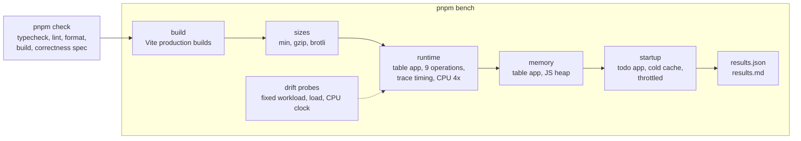

# Gyral benchmarks

The same six apps written in Gyral, React, Preact, Vue, Svelte, Solid and Lit, checked by one
correctness spec, then measured for bundle size, runtime, memory and startup.

[](LICENSE)
[](package.json)
[](https://pnpm.io)
[](results/2026-10-12-full/NOTES.md)
[](docs/apps.md)

- [Why this exists](#why-this-exists)
- [Results, 2026-10-12: Gyral 0.3.1](#results-2026-10-12-gyral-031)
- [How it works](#how-it-works)
- [Run it](#run-it)
- [Conventions](#conventions)
- [Dependencies](#dependencies)
- [Earlier runs](#earlier-runs)

## Why this exists

[Gyral](https://gyral.dev) is a Model-View-Intent framework for web components, and this
repository is its author measuring it against the frameworks people actually choose. Claims
about a framework's size and speed are cheap; this repository makes them checkable, and it
reports the places where Gyral loses as plainly as the places where it wins.

To keep the comparison about the frameworks and not about the app code:

- **The same six apps in every framework** (a floor, a counter, a todo list, a debounced
  search, a signup form and the js-framework-benchmark keyed table), each written the way that
  framework's official documentation recommends. [docs/apps.md](docs/apps.md) lists the idioms
  each one uses.
- **One correctness spec for all of them.** A Playwright spec runs against every production
  build, so a fast but broken implementation can't win.
- **Shared inputs.** Row data, the fake search API and the validation rules are the same code
  for everyone. No UI, state or form libraries.
- **Four measurements:**
  - **Bundle size** of every app: minified, gzip and brotli, plus the framework's floor (an
    app that renders one paragraph).
  - **Runtime:** the nine js-framework-benchmark operations on a keyed table, with in-page
    warm-up, under 4x CPU throttling, 15 interleaved runs each, timed from Chrome performance
    traces with a script / style+layout / paint breakdown.
  - **Memory:** JS heap of the table app after load, with 1,000 rows, and after clearing.
  - **Startup:** the todo app on a cold cache with a throttled network and CPU, until the
    first todo can be added.

What it is not:

- **Not a replacement for [js-framework-benchmark](https://github.com/krausest/js-framework-benchmark).**
  It borrows that project's table operations and its trace-timing rule, but it covers seven
  frameworks rather than dozens, and all of its implementations were written here rather than
  contributed by each framework's own community.
- **One machine.** Headless Chromium on one Linux desktop (an Intel Core i5-10400, 12 threads).
  Absolute numbers will differ on yours; compare frameworks within one run, not across runs.
- **Written by an interested party.** Every implementation follows its framework's documented
  idioms, and none is tuned to move a result, but an expert in any of these frameworks may know
  a better documented way. If you see one, please [open an issue](https://github.com/gyraljs/benchmarks/issues).
- **Client-side rendering only.** Server rendering, hydration and real-world apps are out of
  scope.

## Results, 2026-10-12: Gyral 0.3.1

Gyral 0.3.1 and Gyral 0.3.0, both from npm, against the current releases of the others, all
measured in one run. This run measured 0.3.1 in the `gyral` slot, which has since moved to 0.3.8
([The Gyral slots](#the-gyral-slots)); 0.3.2 through 0.3.6 build byte-identical apps, 0.3.7's are 8 to 31 bytes larger per app, and 0.3.8's another 103 to 196 bytes (JS, gzip -9). Full tables: [results.md](results/2026-10-12-full/results.md); notes:
[NOTES.md](results/2026-10-12-full/NOTES.md); every sample is in `results.json`.

|                                                    | Solid | Preact |  Lit | **Gyral 0.3.1** | Gyral 0.3.0 | Svelte |  Vue | React |
| -------------------------------------------------- | ----: | -----: | ---: | --------------: | ----------: | -----: | ---: | ----: |
| JS, gzip KiB: floor (framework alone)              |   3.7 |    4.8 |  5.8 |         **7.9** |        11.7 |    9.0 | 23.0 |  66.1 |
| JS, gzip KiB: todo app                             |   6.6 |    6.1 |  7.3 |         **9.9** |        13.6 |   14.2 | 25.0 |  66.6 |
| Todo app interactive, cold, throttled (ms, median) |   421 |    406 |  419 |         **438** |         436 |    463 |  516 |   752 |
| Table runtime, geometric mean vs fastest           |  1.08 |   1.37 | 1.30 |        **1.07** |        1.05 |   1.08 | 1.17 |  1.51 |
| Same, without select row                           |  1.09 |   1.25 | 1.27 |        **1.01** |        1.02 |   1.02 | 1.11 |  1.52 |
| JS heap after load (MB)                            |  1.16 |   1.21 | 1.23 |        **1.22** |        1.22 |   1.23 | 1.36 |  1.58 |

Lower is better in every row; a geometric mean of 1.00 would mean fastest at every operation.
The row without select row is computed from the medians in the notes, not by the harness.

What the numbers say:

- **Runtime: 0.3.1 runs at 0.3.0's speed.** Every operation except select row is within 3% of
  0.3.0, and script time within 0.7 ms below 10,000 rows. Gyral, Svelte and Solid lead again:
  Svelte is fastest at create, replace, swap and create 10,000, Gyral at remove and clear.
  Without select row, Gyral 0.3.1 has the lowest geometric mean (1.01; Svelte and 0.3.0 1.02).
- **Select row is frame-aligned: don't read 13.7 vs 11.4 ms as a regression.** Samples are
  bimodal, depending on whether a frame was already due when the click landed, and the split
  moves between runs for every framework ([the methodology's limits](docs/methodology.md#limits)).
- **Size: the floor drops from 11.7 to 7.9 KiB gzip,** almost entirely from `clientOnly` builds
  (0.3.1's preset option, used by create-gyral's client-rendered template), which drop the
  hydration and fallback chunks. Built with the default preset, 0.3.1 is about 0.3 KiB larger
  than 0.3.0. Gyral is now smaller than Svelte for every app; Lit, Preact and Solid still ship
  less.
- **Startup and memory are unchanged from 0.3.0:** interactive at 438 ms (Preact 406, Lit 419,
  Solid 421, Svelte 463), and the same heap (only Lit holds 1,000 rows in less).

Caveats for this run:

- **Machine drift was flagged** (calibration spread 5.6%, limit 5%; load up to 6.2 on 12
  cores): other repositories' self-hosted CI runners share this machine. Interleaving spreads
  the noise over every framework, so compare frameworks within this run, not absolute numbers
  across runs.
- **lit-html is pinned to 3.3.0** for Lit (`overrides` in `pnpm-workspace.yaml`), not the current 3.3.3, whose
  `repeat` leaves an empty comment node behind for every removed item
  ([lit/lit#5010](https://github.com/lit/lit/issues/5010)). Gyral doesn't use Lit.
- **Runtime is timed from Chrome performance traces,** like js-framework-benchmark
  ([methodology](docs/methodology.md#trace-based-timing-default-since-2026-10-05)), so
  operations shorter than a frame include waiting for the frame that paints them.

### The Gyral slots

Two Gyral packages are measured, both installed from npm and pinned exactly:

- `frameworks/gyral` is the current release, **Gyral 0.3.8**, written to the 0.3.1
  documentation (`define<State, Msg>()(tag, spec)`, `intentsOf` for pure list rows, `clientOnly`
  builds). 0.3.2 through 0.3.6 only add to 0.3.1 (0.3.3 changes only `@gyral/mcp`; 0.3.4 fixes server rendering and the build-time component scan; 0.3.5 and 0.3.6 add template checks and development warnings), and 0.3.7's behavior changes (init commands after the first render, light-DOM page children, template rule 16) need nothing from these apps: the app sources are unchanged. Through 0.3.6 they build to the same bytes; 0.3.7's builds are 8 to 31 bytes larger per app (JS, gzip -9), below the 0.1 KiB that `pnpm sizes` shows. 0.3.8's behavior changes (render skipping, core as an exact-version peer, a development server that builds once per module version) need nothing from them either, since every view reads only its state; only the Vite config moves, from `gyralVitePreset()` to `gyral()`. 0.3.8's builds are 103 to 196 bytes larger per app than 0.3.7's (JS, gzip -9), 0.1 to 0.2 KiB in `pnpm sizes`.
- `frameworks/gyral-0.3.0` is the previous release, **Gyral 0.3.0**, with the app sources
  measured on 2026-10-07, so a run shows what the newest release changed.

Older results use other ids: up to 2026-10-07, `gyral-next` is Gyral 0.3.0 (from its release
packs) and `gyral` is Gyral 0.2.0. [CONTRIBUTING.md](CONTRIBUTING.md#compare-gyral-releases-gyral-030)
describes how the slots move when Gyral releases again.

## How it works

### Repository layout

```text
shared/src/                  data, fake search API and validation rules every app shares
frameworks/<name>/           one pnpm package per framework: package.json, vite.config.ts
  apps/<app>/                floor, counter, todo, search, form, table
tests/apps.spec.ts           the correctness spec, run against every production build
tests/trace.spec.ts          tests of the trace analysis, and a 20 ms click handler timed to ±2 ms
scripts/                     build, sizes, serve, bench, report, profiling and comparison tools
scripts/lib/                 the measurement code: runtime, trace, memory, startup, drift, stats
results/<date>[-<label>]/    committed runs: results.json (every sample), results.md, NOTES.md
docs/                        methodology, the apps and their contract, profiling
```

The Gyral experiment variants of earlier runs (`gyral-noeffect`, `gyral-twotrack`,
`gyral-pipewise`, `gyral-combo`), their vendored tarballs and their comparison scripts were
retired on 2026-10-12. Their results stay in `results/`, and the code is in git history: commit
72ee36a is the last one that has them (`git checkout 72ee36a`).

### How a run flows



1. **Correctness first.** `pnpm check` builds every app and runs `tests/apps.spec.ts` against
   each production build. Nothing is benchmarked until it passes.
2. **Build and size.** `pnpm bench` builds every app with Vite into `dist/<framework>/<app>/`,
   then compresses each emitted file on its own, as a server would send it.
3. **Runtime.** Each sample opens a fresh page, runs js-framework-benchmark's in-page warm-up,
   forces a garbage collection, throttles the CPU 4x and times one operation with a real mouse
   click, from the click's event dispatch to the paint commit in a Chrome performance trace.
   Rounds interleave the frameworks in shuffled order, so drift during the run spreads over
   all of them.
4. **Memory and startup.** The table app's JS heap after load, with 1,000 rows and after
   clearing; then the todo app in a fresh browser context on a throttled network, until the
   first todo can be added.
5. **Machine state.** A fixed CPU workload, the load average and the CPU clock are probed at
   the start, after every runtime operation and at the end. If the workload's time spreads by
   more than 5%, or the load exceeds half the cores, the run is flagged in `results.md`.
6. **Report.** `results.json` keeps every sample and the run's metadata (commit, machine,
   browser, every framework's installed version); `results.md` is generated from it.

[docs/methodology.md](docs/methodology.md) is the system of record for how each number is
measured: the trace end-point rule and where it differs from js-framework-benchmark, the
validation of the timing, the drift calibration, and the limits of the method. Run notes add
significance tests (a bootstrap interval for the ratio of medians and a Mann–Whitney U test)
where a comparison needs one.

## Run it

You need Node 24 or later, pnpm 12 and a machine that runs Playwright's Chromium. The numbers
in this repository come from Linux, and the lock below uses `flock` (util-linux).

```sh
pnpm install
pnpm exec playwright install chromium
pnpm check           # typecheck, lint, format, build, correctness tests
pnpm bench --quick   # a few samples, to try the harness (results/quick/, not committed)
pnpm bench           # the full run (results/<date>/); about 25 min for all eight packages
```

| Command                                                | What it does                                                                 |
| ------------------------------------------------------ | ---------------------------------------------------------------------------- |
| `pnpm build [--only=gyral,react]`                      | Production builds → `dist/<framework>/<app>/`                                |
| `pnpm test`                                            | The correctness spec against the current builds (Playwright)                 |
| `pnpm sizes`                                           | Bundle sizes of the current builds                                           |
| `pnpm bench [--quick] [--only=…] [--label=<name>]`     | Build and measure everything → `results/<date>/` or `results/<date>-<name>/` |
| `pnpm bench --strict-drift`                            | Exit with an error if the machine drifted during the run                     |
| `pnpm bench --timing=frame`                            | The older in-page end point instead of trace timing (for comparison runs)    |
| `pnpm report results/<run>`                            | Regenerate a run's `results.md` from its `results.json`                      |
| `pnpm validate:timing`                                 | Check the timing method against a page that busy-waits a known time          |
| `node scripts/rank-compare.mjs <out.md> <old> <new>`   | Per-operation ranks of two runs side by side                                 |
| `node scripts/trace-timeline.mjs [--only=…] [--ops=…]` | The main-thread timeline of a table operation, task by task                  |
| `pnpm profile:build`, `:nodes`, `:run`, `:cpu`         | Profiling variants of the table app ([docs/profile.md](docs/profile.md))     |

Without `--only`, `build` and `bench` cover every package in `frameworks/`: the two Gyral slots
and the six other frameworks. A headline run is `pnpm bench --label=full`, under the lock below.

**Keep the machine quiet.** Close other browsers and test suites and wait for a low load
average before a timed run. Commands that drive Chromium can share a lock so that two of them
never overlap: `flock /tmp/gyral-bench.lock pnpm bench …`. The lock only works if everything
that drives a browser on the machine takes it; the 2026-10-07 notes describe two attempts that
were discarded because something didn't.

## Conventions

- **Fairness first.** Each implementation follows its framework's official documentation.
  Nobody tunes one framework, or skips a documented best practice in another, to change a
  result. A change needed for one framework only is explained in [docs/apps.md](docs/apps.md).
- **Current npm releases, pinned exactly;** Vite 8 production builds with each framework's
  official plugin and otherwise identical settings. Nothing is vendored or packed locally. Two
  deliberate exceptions, stated with the results: lit-html is pinned to 3.3.0 for Lit (its
  current 3.3.3 leaks a comment node per removed list item,
  [lit/lit#5010](https://github.com/lit/lit/issues/5010)), and the `gyral-0.3.0` slot keeps
  the previous Gyral release next to the current one.
- **Every app passes the correctness spec** before it is benchmarked.
- **Results are committed, never edited.** Each run is one folder and one commit
  (`results: …`); to change a number, re-run and commit a new folder. `pnpm report` can
  regenerate `results.md`, but `results.json` is the record.
- **Results are reported as measured,** including where Gyral loses. Context from elsewhere is
  cited as context, never as a result of this repository.
- **Code:** files of 300 lines or fewer, no `any`, and `pnpm check` passes.

[CONTRIBUTING.md](CONTRIBUTING.md) has the procedures: adding a framework or an app, running
and committing a benchmark, comparing runs, and moving the Gyral slots to a new release.

## Dependencies

A version comes in only once it has been published for two weeks (`minimumReleaseAge` in
`pnpm-workspace.yaml`, Gyral's ADR 0032); pnpm 12 also checks the lockfile against it on every
install. Besides the two exceptions above, TypeScript stays on 6.0 (typescript-eslint supports
only `<6.1`), and Gyral 0.3.8, the owner-verified release in `frameworks/gyral`, comes in early
through exact `minimumReleaseAgeExclude` entries until 2026-11-12.

**2026-10-29, for Gyral 0.3.8 (epic gyral-337).** Every dependency moved to its newest version
that is two weeks old, with the transitive tree resolved afresh: React and React DOM 19.3.1, Vue
3.5.44, `@babel/core` 8.0.7 (Preact), Playwright 1.64.1, `@types/node` 26.6.5 and
typescript-eslint 8.71.2; in the tree, the Solid compiler (babel-preset-solid 1.9.16) and
rolldown 1.2.14 under Vite 8.3.4. Svelte 5.57.2, Solid 1.9.17, Preact 11.0.1 and Lit 3.3.3 were
already the newest such releases. pnpm moved from 10.33.2 to 12.14.0, and the lit-html override
from `package.json` to `pnpm-workspace.yaml`. The Preact preset (2.10.6, its newest release)
still declares a peer of `@babel/core` 7.x, so installs warn of an unmet peer, but it runs Babel
only when given a `babel` option, which this config doesn't pass: the Preact builds are
byte-identical on 7.29.7 and 8.0.7. Held back as too young: eslint 10.13.0 and svelte-check
4.7.7 (until 2026-10-30), typescript-eslint 8.72 (11-02), Vite 8.3.5 and pnpm 12.15 (11-04),
Preact 11.0.2 and `@babel/core` 8.0.9 (11-06), Svelte 5.57.3 (11-09), Preact 11.1 (11-10) and
`@types/node` 26.6.6 (11-11). seroval 1.6.11 (11-01) fixes two advisories in solid-js's
dependency, but only Solid's server renderer loads seroval, and these apps render on the
client, so it waits. No run has measured these versions yet; each run's `results.md` lists the
versions it measured.

## Earlier runs

Each is comparable only within itself.

- [2026-10-07, full](results/2026-10-07-full/NOTES.md): Gyral 0.3.0 release packs against
  0.2.0 and the others, the previous headline (geometric mean 1.03; floor 11.6 KiB gzip).
- [2026-10-06, Gyral 0.3 final](results/2026-10-06-gyral-0.3-final/NOTES.md): the speed gate
  for Gyral 0.3 (0.3.0-next.6 vs 0.2.0).
- [2026-10-05](results/2026-10-05/results.md): Gyral 0.1.0 on Effect 3 (floor 49.3 KiB gzip),
  lit-html 3.3.3, and the older in-page end point, which often missed the repaint of
  operations shorter than a frame. Gyral's runtime tracked Lit's.
- [2026-10-05, trace-based](results/2026-10-05-lit-html-3.3.0-effect4-trace/NOTES.md): Gyral
  experiment builds (Effect 4, lit-html 3.3.0), the first run with trace timing.
- [2026-10-06, Gyral 0.2.0 confirmation](results/2026-10-06-release-0.2.0-a3/CONFIRMATION.md)
  and [the Gyral 0.3 spike](results/2026-10-06-gyral-next-spike/NOTES.md) (a flagged run,
  under load).

Every run is in [results/](results/).

## License

MIT, © 2026 Mike Zupper; see [LICENSE](LICENSE). Gyral is MIT-licensed as well:
[gyral.dev](https://gyral.dev), [github.com/gyraljs/gyral](https://github.com/gyraljs/gyral).
